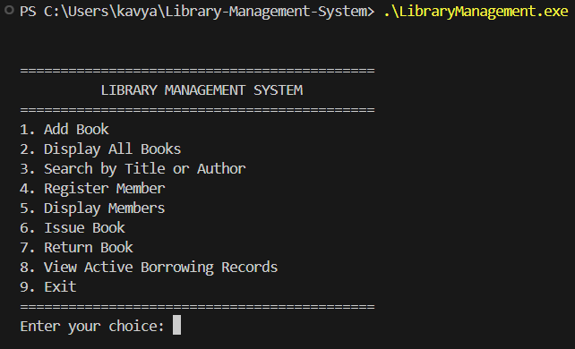

# Library Management System

A console-based Library Management System developed in C++ to manage books, library members, and borrowing records using structures and file handling.


## Overview

This project provides a simple, menu-driven application for managing library books and members. It allows users to register members, search for books, issue books, process returns, and view active borrowing records.

Book, member, and borrowing information is stored in local text files so that records remain available after the program is closed.

## Features

- Add new books with unique book IDs
- Display all available book records
- Search books by title or author
- Register library members
- Display registered members
- Issue books to registered members
- Return previously issued books
- View active borrowing records
- Track total and available book copies
- Prevent duplicate book and member IDs
- Prevent issuing unavailable books
- Prevent duplicate active issues of the same book to a member
- Store records persistently using file handling

## Technologies Used

- C++
- Structures and Functions
- File Input and Output
- Vectors
- String Streams
- Standard Template Library (STL)
- Basic Input Validation

## Project Structure

```text
Library-Management-System/
│
├── LibraryManagement.cpp
├── README.md
├── .gitignore
├── LICENSE
└── demo2.png
```

The application generates these local data files when records are saved:

- `books.txt` — book information
- `members.txt` — registered member information
- `borrow_records.txt` — book issue and return status

These generated data files are excluded from Git using `.gitignore`.

## Demo



The application provides a menu-driven interface for managing library records and book circulation.

## How to Run

### 1. Clone the Repository

```bash
git clone https://github.com/KavyanshGarg/Library-Management-System.git
```

### 2. Open the Project

Open the cloned `Library-Management-System` folder in Visual Studio Code.

### 3. Compile the Program

Make sure a C++ compiler such as GCC is installed and available in your terminal.

```bash
g++ LibraryManagement.cpp -std=c++17 -o LibraryManagement
```

### 4. Run the Program

**Windows PowerShell:**

```powershell
.\LibraryManagement.exe
```

**Linux/macOS:**

```bash
./LibraryManagement
```

## Menu Options

```text
============================================
          LIBRARY MANAGEMENT SYSTEM
============================================
1. Add Book
2. Display All Books
3. Search by Title or Author
4. Register Member
5. Display Members
6. Issue Book
7. Return Book
8. View Active Borrowing Records
9. Exit
============================================
```

## Data Storage

The application maintains three local text files:

| File | Purpose |
|---|---|
| `books.txt` | Stores book details and copy availability |
| `members.txt` | Stores library member details |
| `borrow_records.txt` | Tracks active and completed book issues |

The application loads saved records when needed and updates the files when records change.

**Note:** This is an educational console application. Its text-file storage is intended for local learning and demonstration, not for production library systems.

## Concepts Demonstrated

- Structured programming in C++
- Structures and functions
- File handling
- Vectors and data management
- Searching records
- Book issue and return processing
- Input validation
- Menu-driven application development

## Future Improvements

- Remove or update book records
- Edit and remove member records
- Add due dates and overdue tracking
- Generate borrowing reports
- Integrate a database
- Develop a graphical user interface

## Author

**Kavyansh Garg**

## License

This project is licensed under the MIT License. See the [LICENSE](LICENSE) file for details.